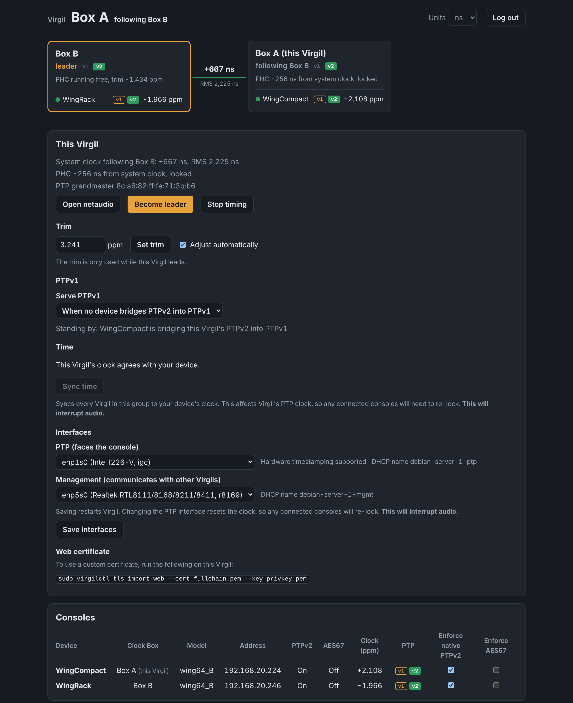
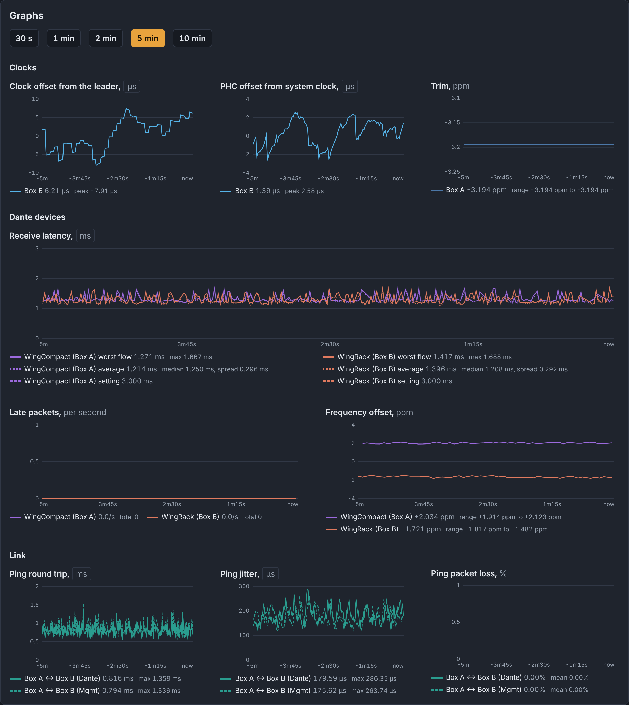

*Vuolsi così colà dove si puote, Audinate.*

# Virgil

**Dante over a wireless bridge**

Virgil acts as a local clock master for Dante devices. Installed on a small Debian device, multiple Virgils can be synced together across wireless bridges to create a multi-zone Dante deployment without the issues that arise from trying to sync PTP clocks over a jittery wireless network.

[Install](#install) · [Getting started](#getting-started) · [Using Virgil](#using-virgil) · [How it works](#how-it-works) · [Design](docs/design.md) · [wireless-dante](https://github.com/BRCook/wireless-dante)



> [!NOTE]
> This project is AI-assisted.

## What you get

Dante consoles agree on the time using PTP, and PTP doesn't survive a wireless bridge: the radio adds far more jitter than PTP can cope with. In [wireless-dante](https://github.com/BRCook/wireless-dante), we solved this with a **Clock Box** on each side of the link, plugged into the console, keeping the two sides in step over NTP (which is far more forgiving) and serving each console its own PTP. It worked, but every Clock Box was configured by hand.

Virgil does all of that for you. Install it on each Clock Box, put them in a group, and watch the magic happen.

## Features

| Area                | What it does                                                                                                                         |
|---------------------|--------------------------------------------------------------------------------------------------------------------------------------|
| **Leadership**      | The Clock Boxes find each other and elect a leader. If the leader disappears for any reason, another Virgil takes over seamlessly. A **Become leader** button in the UI will force a transfer of power. |
| **Clock trim**      | The leader slowly steers its clock rate towards what the consoles prefer. The stress of wrangling an unusually fast or slow clock then lies with Virgil rather than the console. |
| **Console control** | Turn on native PTPv2 or AES67 mode on supported consoles via [netaudio](https://github.com/BRCook/netaudio). |
| **PTPv1**           | Serves PTPv1, the native language of Dante, if necessary.                                                                            |
| **Alerts**          | Lost locks, muted audio and late packets are all reported in Virgil's UI for quick reference.                                        |
| **Data**            | The last 10 minutes of clock offsets, receive latency, late packets, and the link's round trip, jitter and loss are graphed in the web UI. |
| **Logging**         | Records logs and performance data on both Clock Boxes at once, with optional notes. Built for soak testing.                          |
| **Housekeeping**    | Real NIC names, custom DHCP lease names, missing interface setup, sync time from your device, your own TLS certificate, and netaudio's UI behind Virgil's login. |



## How it works

```
   STAGE SIDE                                RADIO LINK                                   FOH SIDE

 ┌───────────┐   PTP   ┌───────────────┐   NTP (filtered)    ┌───────────────┐   PTP   ┌──────────────┐
 │ Wing Rack │◄────────│  Clock Box B  │ ◄──────────────────►│  Clock Box A  │────────►│ Wing Compact │
 └───────────┘  cable  └───────────────┘   wireless bridge   └───────────────┘  cable  └──────────────┘
       ▲                                                                                       ▲
       └─────────────────────────── Dante audio (crosses the link) ────────────────────────────┘

                  PTP multicast is blocked from crossing the link in both directions
```

One Clock Box is the **leader**, and its clock runs free. The other is a **follower**, and follows the leader over NTP, which (unlike PTP) copes perfectly well with a jittery link once it's filtered properly. Each Clock Box serves PTP to its own console over a cable. Which Clock Box acts as the "clock leader" doesn't matter, and can change at any time without the consoles noticing.

Virgil itself is never in the timing path. chrony, ptp4l and phc2sys do the actual timekeeping; Virgil simply sets them up, starts and stops them, and watches everything. If Virgil crashes, the essential timing services carry on.

The background, and why any of this works, is in [wireless-dante](https://github.com/BRCook/wireless-dante). Everything about how Virgil implements these concepts is in the [design document](docs/design.md).

## Requirements

| Requirement | Check | Notes |
|---|---|---|
| Two Clock Boxes running **Debian 13** (x86_64 or aarch64) | `cat /etc/debian_version` | Any machine will do. Virgil is not heavy. |
| A NIC with **hardware timestamping**, facing the console | `ethtool -T enp1s0` shows `hardware-transmit` and a PTP hardware clock | The Intel i226 is tested. A second NIC for management is best rather than mixing Dante and control traffic. |
| A link that passes Dante, but **blocks PTP** | `sudo tcpdump -ni enp1s0 dst 224.0.1.129` shows nothing from the far side | You must block 224.0.1.129 from crossing the bridge. How you do this is not in the scope of this project. |
| Consoles that can do **PTPv2**, or Dante devices that do PTPv1 | Shown on Virgil's **Consoles** page | Virgil can turn native PTPv2 on if the console supports it, but can use PTPv1 if necessary. |
| Internet access while installing | | Internet access is not required for regular use, **only** for installation. |

Virgil's PTP is not immune to the multicast handling issues that regular Dante clocks face. You should be familiar with IGMP snooping and queriers and how your network infrastructure handles multicast traffic before using Virgil. Virgil is not a replacement for Dante, it is an *extension* of it.

## Install

On each Clock Box:

```bash
git clone https://github.com/BRCook/dante-virgil.git
cd dante-virgil
sudo ./install.sh
```

```bash
git pull && sudo ./install.sh     # Update: keeps your settings
sudo ./uninstall.sh               # Uninstall (add --purge to remove your settings too)
```

## Getting started

Choose the interfaces, and set a password for the web UI, on each Clock Box:

```bash
virgilctl interfaces                               # See which NIC is which
sudo virgilctl config set ptp_interface enp1s0     # The NIC that will serve PTP (choose one with hardware timestamping)
sudo virgilctl config set mgmt_interface enp5s0    # The NIC for everything else
sudo systemctl restart dante-virgil
sudo virgilctl password
```

Put the Clock Boxes in a group:

```bash
sudo virgilctl group create        # On the first Clock Box
sudo virgilctl group invite        # Prints a one-time token
sudo virgilctl group join <token>  # On the second Clock Box
```

Then open either Clock Box at `http://<its address>` and enjoy the show.

## Using Virgil

Every Clock Box serves the same web UI, showing the whole group. Anyone who can reach it can look; changing anything needs the password. Your browser will complain about the certificate unless you [use your own](docs/design.md#web-certificate).

| Section          | What's there                                                                                         |
|------------------|------------------------------------------------------------------------------------------------------|
| **Alerts**       | Anything wrong with either console.                                                                  |
| **Timing chain** | Both Clock Boxes, how far apart they are, and each detected console. The **v1** and **v2** badges show which PTP version each Clock Box serves, and which each console follows. |
| **This Virgil**  | Its clock, **Become leader**, the trim, PTPv1, **Sync time**, its interfaces, and its certificate.    |
| **Consoles**     | Every console in the group and its settings.                                                         |
| **Logging**      | Start, add notes, stop, and download.                                                                |
| **Graphs**       | The last 30 seconds to 10 minutes of everything.                                                     |
| **Events**       | Alerts, and what the group did: joins, leaves, new leaders, the time being set, and PTPv1 switching. |
| **Group**        | Invites, joining, and the other Clock Boxes.                                                         |

> [!WARNING]
> **Sync time interrupts audio.** On a Clock Box, the time of day and the consoles' clock are the same clock, so both consoles re-lock when it changes. The button asks twice for a reason.

Everything is available in the CLI:

```bash
virgilctl status               # Both Clock Boxes, both consoles, and any current alerts
virgilctl events               # Recent alerts
virgilctl trim                 # The trim, and each console's clock
sudo virgilctl role lead       # Make this Clock Box the leader
```

## Documentation

| Document | Contents |
|---|---|
| [Design](docs/design.md) | How Virgil works, in more detail than you probably want: architecture, timing, elections, PTPv1, alerts, configuration and APIs. |
| [Configuration](docs/design.md#configuration) | Every setting in `/etc/dante-virgil/virgil.toml`. |
| [virgilctl](docs/design.md#virgilctl) | Every command. |
| [API](docs/design.md#apis) | The web UI's API, for monitoring tools such as Headhunter. |
| [wireless-dante](https://github.com/BRCook/wireless-dante) | Where this started, and why any of it works. |

## Tested hardware

| Part | What I used |
|---|---|
| Consoles | Behringer Wing Rack and Wing Compact, internal Dante modules |
| Clock Boxes | Two small x86 machines running Debian 13 |
| PTP NIC | Intel i226 |
| Management NIC | Onboard Realtek RTL8168evl/8111evl (`r8169`) |
| Radio | Cambium cnWave V1000 |

Other NICs with hardware timestamping should work, but I've only tested the i226, so for anything else… good luck!

## Current limitations

- Each Clock Box's settings are local to that Clock Box. Settings are not shared. Is this even desirable?
- Only one radio hop has been tested. Multiple are possible with sufficient latency budget.

## Contributing and license

Bug reports and pull requests are welcome; please open an [issue](https://github.com/BRCook/dante-virgil/issues) first for anything big. Virgil is released under the [AGPL-3.0-or-later](LICENSE).

> [!WARNING]
> Virgil is an independent project, and is not affiliated with, endorsed by or supported by Audinate (who make Dante), Behringer, or anyone else. Virgil *changes the clocking of live consoles*; use it at your own risk. Test **thoroughly** before taking it anywhere near a real show. I am not responsible if you break anything.

## Credits

Virgil started life as [wireless-dante](https://github.com/BRCook/wireless-dante), a hand-built prototype that proved the idea.

It uses [netaudio](https://github.com/chris-ritsen/network-audio-controller) by Christopher Ritsen, through [my fork](https://github.com/BRCook/netaudio), which adds PTPv2 control (and a lot more). Christopher's original is released under the Unlicense, and my changes under the AGPL-3.0-or-later. The actual timekeeping is done by [chrony](https://chrony-project.org/) and [linuxptp](https://linuxptp.nwtime.org/).
